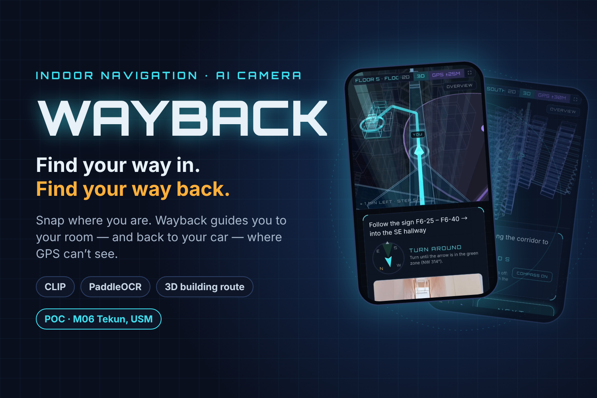

# Wayback

Wayback finds where you are inside a building from your phone camera, then guides you by the shortest route.

- **Demo video:** https://youtu.be/RzueeV50nw4
- **Live app:** https://wayback-m06-1626.web.app (open it on a phone; it only gives real results at M06)

## Problem

In Kuala Lumpur malls, my family often comes out and can't remember where we parked. Every level looks the same: pillars, bays and doors repeat. A photo of the parking spot helps us remember it, but it doesn't lead us back.

I had the same problem as a new resident at my dorm, M06 at Tekun, USM. GPS doesn't help: it drifts underground and indoors, and it can never tell one floor from another.

## Solution

What if your camera could be the map pin?

- **Save your parking spot.** Snap four sides (front, right, back, left). The AI matches them against reference photos of the building and reads any sign it sees.
- **Go to your room.** Type a room such as F6-26 and follow step-by-step directions on a 3D view of the building.
- **Find my car.** Capture where you are and get the shortest way back to the car.
- **Where to?** No car needed: type a room, capture around you, and navigation starts from right there.

## How I did it

**Survey mode** collects the reference photos: pin a spot on the floor plan, save GPS, capture four sides, and view saved places. CLIP only needs labelled reference photos, which Survey mode collects, so there's no model training.

Then everything runs free and on the phone, with no paid AI service:

1. **Photo matching with CLIP**, run in the browser.
2. **Sign reading with PaddleOCR.** If a sign is read, the sign wins over the photo match.
3. **GPS as support only.** GPS never decides the floor.
4. **Shortest route** with Dijkstra's algorithm. It's plain maths, not AI.

Built with Next.js, TypeScript, Tailwind, three.js and Firebase. Setup and commands are in [`wayback/README.md`](wayback/README.md).

---

© 2026 Yein123
